[English](README.md) · [Português](README.pt-BR.md) · [Español](README.es.md) · **العربية**

<a id="top"></a>

<div dir="rtl">

<p align="center">
  <a href="#install"></a>
</p>

<h1 align="center">editonny</h1>

<p align="center"><strong>أنت تطلب. وفيديوك يكتسب إيقاعه.</strong></p>

<p align="center">مهارة مجانية ومفتوحة المصدر لمونتاج الفيديو في <strong>Claude Code</strong> و<strong>Codex</strong>. احذف السكتات والأخطاء، وأضف الترجمة النصية، وأصلح الصوت، وغيّر المقاس، وحوّل أجزاء من كلامك إلى مشاهد موشن بمجرد أن تطلب بلغة بسيطة. التفريغ النصي والتصيير يعملان على جهازك.</p>

<p align="center">
  <a href="https://github.com/soumatheusgomes/editonny/stargazers"></a>
  <a href="https://github.com/soumatheusgomes/editonny/actions/workflows/verify.yml"></a>
  <a href="LICENSE.md"></a>
  
  
</p>

<p align="center"><a href="#install"><strong>التثبيت بطلب واحد</strong></a> · <a href="#how-it-works">كيف يعمل</a> · <a href="#lab">المختبر</a> · <a href="#motion">مشاهد الموشن</a> · <a href="#open-the-guide">الدليل</a> · <a href="#community">تاريخ النجوم</a></p>

<p align="center"></p>

<a id="install"></a>

## التثبيت بطلب واحد

لن تنزّل أي شيء يدويًا. افتح **Claude Code** أو **Codex** في أي مجلد والصق هذا الطلب. الطلب نفسه يثبّت editonny في المرة الأولى ويحدّثه لاحقًا: يستنسخ وكيلك المهارة من GitHub، ويتبع إجراء الإعداد الخاص بها، ويتحقق من كل شيء، ويسألك قبل أي شيء خارج الطلب.

</div>

```text
ثبّت أو حدّث مهارة editonny لـ Codex وClaude Code من https://github.com/soumatheusgomes/editonny. استنسخ أحدث إصدار في مجلد مؤقت؛ لن أنزّل أي شيء بنفسي. اقرأ skills/editonny/SKILL.md واتبع إجراء الإعداد الكامل الخاص به. إذا كان editonny مثبتًا بالفعل، فقارن الإصدارات، ولخّص ما سيتغير، وحدّثه بطريقة التسليم الحالية: مثبّت المستودع للتثبيت المشترك (يحافظ على إعداداتي ويحتفظ بنسخة احتياطية من النسخة السابقة) أو أداة التحديث الخاصة بالمضيف للإضافة المُدارة. جهّز الأدوات المحلية المتوافقة، والمحرك المقفل، ومحرك التصيير والمتصفح المثبّتين بإصدار محدد، ونموذج التفريغ النصي الافتراضي، وOCR المحلي لفحص الترجمة، والوسائط المرفقة قبل أول مونتاج. تحقق بالتشخيص وعينة اصطناعية، وأبلغني بأي شيء معلّق، واحذف النسخة المؤقتة، وأخبرني متى أعيد تشغيل وكيلي. اسألني قبل استخدام خدمات مدفوعة أو إرسال الوسائط الخاصة بي.
```

<div dir="rtl">

<p align="center"></p>

عند الانتهاء، أعد تشغيل وكيلك واستدعِ **`/editonny` في Claude Code** أو **`$editonny` في Codex**. هذا هو الطلب نفسه الذي ينسخه لك الدليل.

| ستحتاج إلى | الإصدار |
|---|---|
| Claude Code أو Codex | مُعدّ مسبقًا |
| Python | 3.9+ للمشغّل؛ والمحرك يستخدم >=3.10,<3.14 عبر uv |
| uv | مدير Python |
| FFmpeg وffprobe | متاحان في `PATH` |
| Node.js وnpx | 22.13+ أو 24+ |
| OCR محلي لفحص الترجمة | Apple Vision (macOS) أو Tesseract |

يجهّز الوكيل ما ينقص ويبلغك بأي تنزيلات معلّقة أو فحوصات فاشلة قبل أن يعتبر الإعداد مكتملًا. التفريغ النصي والتصيير المحليان لا يحتاجان إلى مفتاح API لنموذج لغوي؛ واشتراك وكيلك منفصل. المولّدات الخارجية اختيارية وتتطلب إذنك قبل أي تكاليف أو إرسال للوسائط.

<details>
<summary><strong>تفضّل الطرفية؟</strong></summary>

</div>

```sh
git clone https://github.com/soumatheusgomes/editonny.git
cd editonny
python3 install.py --target both
python3 ~/.local/share/editonny/scripts/editonny.py doctor
python3 ~/.local/share/editonny/scripts/editonny.py media status
```

<div dir="rtl">

استخدم `--target codex` أو `--target claude` لتسجيل وكيل واحد. يوجد تثبيت مشترك واحد في `~/.local/share/editonny`؛ وتسجيلات الوكلاء روابط إليه. تسجّل هذه الأوامر المهارة وتجهّز بيئة Python الخاصة بها. للإعداد الكامل (محرك التصيير، والمتصفح، ونموذج التفريغ النصي، وOCR، والفحوصات الاصطناعية)، اطلب من وكيلك قراءة `skills/editonny/SKILL.md` واتباع [إجراء الإعداد](skills/editonny/references/setup.md). كل استخدام يتحقق من الجاهزية المحلية وتحديثات GitHub؛ وتطبيق أي تحديث يتطلب موافقتك.

راجع [التثبيت والاستعادة](docs/installation.md) للتثبيت المعزول وتحميل الإضافة والتحديثات والإزالة.

</details>

<a id="how-it-works"></a>

## كيف يعمل

<p align="center"></p>

editonny مهارة مثبتة على جهازك. تصف النتيجة وتوجّه وكيلك إلى مجلد الفيديو؛ فتفحص المهارة التسجيل، وتختار اللقطات المكتملة، وتقيس القطعات على الموجة الصوتية، وتجمع مشروعًا، وتراجع عينة تمثيلية، وتصدّر ملف MP4 تم فحصه.

</div>

```text
$editonny
عدّل فيديو طوليًا مدته 45 ثانية من /path/to/footage.
احتفظ باللقطات المكتملة، واحذف السكتات والأنفاس والأخطاء، وأضف ترجمة نصية واضحة.
استخدم المشاهد البصرية فقط حيث تشرح القصة.
تحقق من عينة مدتها من 8 إلى 15 ثانية قبل إنهاء التصدير.
```

<div dir="rtl">

1. اختر هدفًا في الدليل، وحدد مجلد المادة المصورة، وانسخ الطلب (بلغة الدليل) إلى وكيلك.
2. تفحص المهارة المصادر المختارة، وتقترح كل إعدادات المونتاج، و**تنتظر تأكيدك**، حتى مع طلب مفصل. الإعدادات الافتراضية تحافظ على الصورة الأصلية والأبعاد وعدد الإطارات؛ والفلاتر اللونية والتحويلات ليست تلقائية أبدًا.
3. بعد الموافقة، يبقى العمل في **Downloads/editonny/التاريخ-العنوان/**: الفيديوهات النهائية في **exports/**، وملفات المونتاج في **project/**. راجع عينة مدتها **من 8 إلى 15 ثانية**؛ واختر موافقة المستخدم إذا أردت أن ينتظرك الوكيل في هذه الخطوة أيضًا.
4. مسار تصيير مدعوم ينشر ملفات MP4 وترجمة بأسماء فريدة مع ملف تحقق مطابق. المسارات اللونية أو الزمنية غير المدعومة تتوقف بوضوح؛ والتنفيذ عن بُعد يجب أن يحدد وجهة يمكن الوصول إليها.

التنظيف القياسي يحذف السكتات غير الضرورية والأنفاس المسموعة والأخطاء والبدايات الخاطئة والتكرارات الزائدة، مع الحفاظ على الكلمات كاملة والإيقاع الطبيعي والسكتات المقصودة والمعنى. التعديلات المحددة تبقى داخل النطاق المطلوب. المادة الأصلية محفوظة، ويمكن أن يبقى الكلام بلغته الأصلية.

## كل طلب هو طبقة

<p align="center"></p>

## خدمتان، مسار واحد

<p align="center"></p>

<a id="lab"></a>

## المدخل، الطلب، النتيجة

<p align="center"></p>

<p align="center"></p>

<p align="center"></p>

<a id="motion"></a>

## الكلام يصبح مشهدًا

<p align="center"></p>

<p align="center"></p>

تأتي المشاهد من الكتالوج المرفق الذي يضم **145** مشهد موشن و**79** مقطعًا أصليًا؛ ولا يحصل كل مشروع إلا على المقاطع التي يستخدمها. الأرقام والعروض والشهادات والعلامات التجارية في المشاهد توضيحية ويجب استبدالها بحقائق مقدمة. لا تعامل المرئيات المولّدة كدليل أبدًا. كل الصور في هذا الملف رسوم متحركة توضيحية لطريقة العمل، وليست تصييرًا لمادة عملاء.

<a id="open-the-guide"></a>

## افتح الدليل

الدليل هو موقع editonny: يبني طلبات المونتاج، ويتيح تصفح 145 مشهد موشن و54 طلبًا نموذجيًا، ويشرح التثبيت بالإنجليزية أو البرتغالية البرازيلية أو الإسبانية أو العربية (حسب متصفحك؛ ويبقى اختيارك ووصفك محفوظين في ذلك المتصفح). لا يستقبل أي مادة مصورة ولا يرفعها أبدًا.

لتشغيله محليًا من هذا المستودع (Node.js 22.13+ أو 24+):

</div>

```sh
npm ci
python3 editonny.py guide
```

<div dir="rtl">

يشغّل هذا خادم التطوير على `http://localhost:4173` ويفتحه. أوقفه بـ `Ctrl+C`؛ واستخدم `--port` لاختيار منفذ آخر و`--no-open` لتجنب فتح المتصفح. الأمر `npm run dev` يفعل الشيء نفسه على المنفذ 3000.

## البنية

| المسار | المسؤولية |
|---|---|
| `skills/editonny/` | مهارة محمولة واحدة وواجهة سطر الأوامر |
| `skills/editonny/engine/` | المعالجة المحلية والمعاينة وقالب المشروع الإنجليزي |
| `skills/editonny/visuals/` | المشاهد والكتالوج والوسائط المرفقة والوصفات |
| `web/` | الدليل العام: تطبيق Next.js بمنشئ طلبات مترجم وكتالوج وأمثلة وتثبيت |
| `DESIGN.md` | العقد البصري والمصدر المرجعي لرموز التصميم |
| `design-system/` | مكتبة مكونات React والرموز وقوالب المعاينة والعرض وHTML المرجعي |
| `docs/` | مراجع البنية والتثبيت والتكامل والتحقق المعتمدة |
| `scripts/` و`tests/` | الحزم وصور README وفحوصات التصيير واختبارات الانحدار |

المشاريع الجديدة تستخدم `project.json` وأوامر وحقولًا ومعرّفات مشاهد بالإنجليزية. هذا أساس نظيف لما قبل الإصدار؛ وصيغ المشاريع التجريبية السابقة غير مدعومة.

<details>
<summary><strong>التطوير والتحقق والتوزيع</strong></summary>

## التطوير والتحقق

</div>

```sh
npm ci --ignore-scripts
uv sync --locked --directory skills/editonny/engine
npm run build
npm run check
python3 editonny.py doctor
npm run test:engine
npm run test:browser
npm run test:preview
npm run test:scenes
npm run test:three
python3 scripts/smoke_engine.py
```

<div dir="rtl">

الأمر `npm run test:browser` يبني الدليل ويشغّل Playwright (ثبّت Chromium الخاص به مرة واحدة بـ `npx playwright install chromium`). فحوصات المعاينة والمتصفح ثلاثي الأبعاد (`npm run test:preview` و`npm run test:three`) تتطلب `agent-browser`. فحوصات التصيير تتطلب FFmpeg واتصالًا بالشبكة عند أول استخدام لـ HyperFrames. افحص العينات الناتجة قبل حذف مخرجات المهام من `.work/`. الأوامر الكاملة والنتائج والقيود المعروفة موجودة في [التحقق](docs/validation.md).

المستودع عبارة عن npm workspace: `web/` (`@editonny/web`) و`design-system/` (`@editonny/design-system`). الأمر `npm run build` يبني الدليل؛ و`npm run check` يشغّل الفحص اللغوي وفحص الأنواع واختبارات الوحدات وفحص سجل الأيقونات (`npm run icons` يعيد توليده من `design-system/assets/icons/`). افتح `/design-system` على الدليل قيد التشغيل لتصفح كل مكون وحالة في الوضعين؛ وأي واجهة جديدة تتبع [DESIGN.md](DESIGN.md) و[خريطة المكتبة](design-system/README.md).

صور README تُولَّد من نصوص واجهة الدليل ورموز DESIGN.md: شغّل `npm run readme:art` بعد تغيير أي منهما. يفشل `npm test` عندما تكون صورة قديمة، ويجب أن يطابق طلب التثبيت في كل README طلب الدليل.

### نشر الدليل

استورد المستودع في Vercel واضبط **Root Directory** على `web`؛ يثبّت Vercel مساحة العمل من جذر المستودع ويُبقي كتالوج المهارة متاحًا للبناء. اضبط `NEXT_PUBLIC_SITE_URL` على العنوان العام (مثل نطاق مخصص) لكي تستخدمه الروابط المرجعية و`hreflang` وخريطة الموقع والبيانات المنظمة وصور المشاركة المترجمة؛ وإلا يُستخدم نطاق Vercel الإنتاجي.

## الحزمة

</div>

```sh
python3 scripts/package.py
```

<div dir="rtl">

ينشئ هذا ملف ZIP للإضافة مع ملف SHA-256 في `dist/`. يتضمن التوثيق المعتمد والمهارة كاملة و**79 فيديو مرفقًا**؛ ولا تحصل المشاريع إلا على المقاطع التي تستخدمها. يُنشر الدليل كموقع ولا يُضمَّن في الأرشيف. بناء الحزمة لا ينشرها ولا يحدّث تثبيتك العام.

</details>

<a id="community"></a>

## تابع القصة

إذا ساعدك editonny في فيديوك القادم، فامنح المشروع نجمة. تابع تقدمه، أو أبلغ عن مشكلة، أو شارك فكرة لمشهد.

<a href="https://www.star-history.com/?repos=soumatheusgomes%2Feditonny&amp;type=date">
  <picture>
    <source media="(prefers-color-scheme: dark)" srcset="https://api.star-history.com/chart?repos=soumatheusgomes/editonny&amp;type=date&amp;theme=dark" />
    
  </picture>
</a>

[امنح المشروع نجمة](https://github.com/soumatheusgomes/editonny/stargazers) · [أبلغ عن مشكلة](https://github.com/soumatheusgomes/editonny/issues) · [افتح تاريخ النجوم](https://www.star-history.com/?repos=soumatheusgomes%2Feditonny&type=date)

تاريخ النجوم المباشر مقدم من [Star History](https://www.star-history.com/blog/how-to-use-github-star-history/) ويعتمد على تلك الخدمة. الشارة أعلاه تعرض العدد الحقيقي للنجوم على GitHub.

## المؤلف والتواصل

أنشأه ويديره **Matheus Gomes**.

- Instagram: [@matheusgomes](https://instagram.com/matheusgomes)
- البريد الإلكتروني: [eu@matheusgom.es](mailto:eu@matheusgom.es)
- GitHub: [soumatheusgomes/editonny](https://github.com/soumatheusgomes/editonny)

## الرخصة والموارد

الكود والتوثيق الأصليان يستخدمان [رخصة MIT](LICENSE.md). المكتبات والنماذج والخطوط والأصوات والوسائط الخارجية تحتفظ برخصها ونسبتها الخاصة؛ ورخصة MIT لا تعيد ترخيص تلك الموارد. راجع [إشعارات الجهات الخارجية](skills/editonny/engine/THIRD_PARTY_NOTICES.md) والإشعارات المرفقة بجانب الموارد قبل إعادة التوزيع.

[المنتج](PRODUCT.md) · [البنية](docs/architecture.md) · [الواجهة](docs/design.md) · [التكاملات](docs/integrations.md) · [إعداد التطوير](docs/setup.md)

<p align="center"><strong>القصة عندك. والإيقاع علينا.</strong><br /><a href="#top">العودة إلى الأعلى ↑</a></p>

</div>
